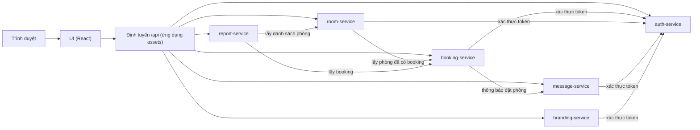
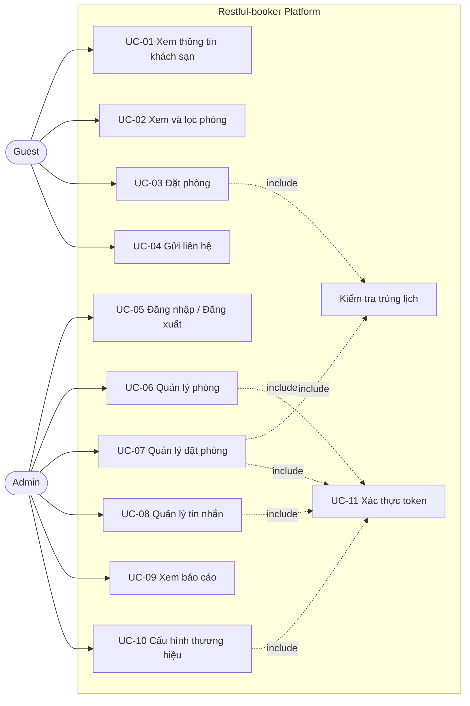
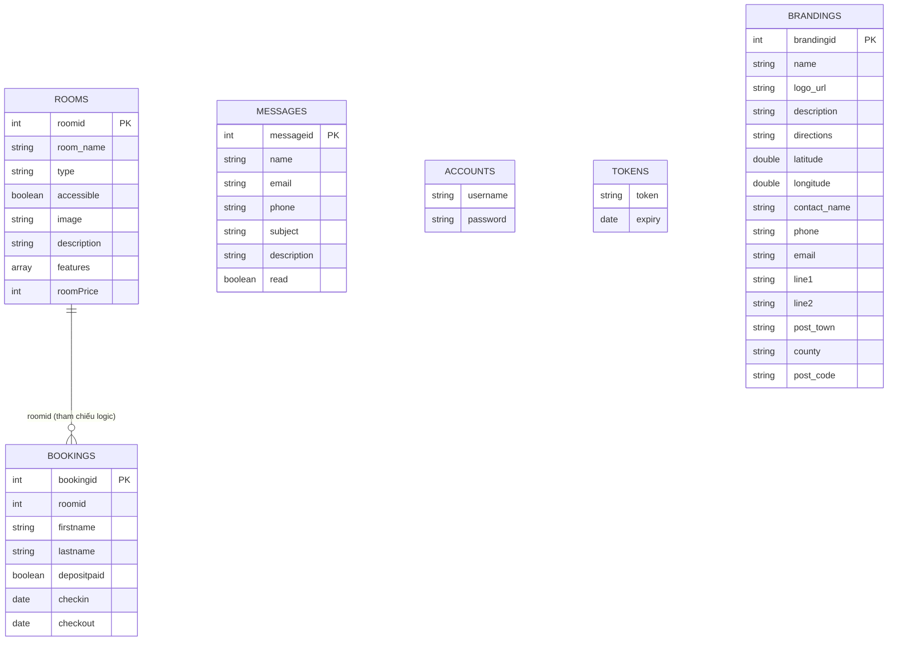
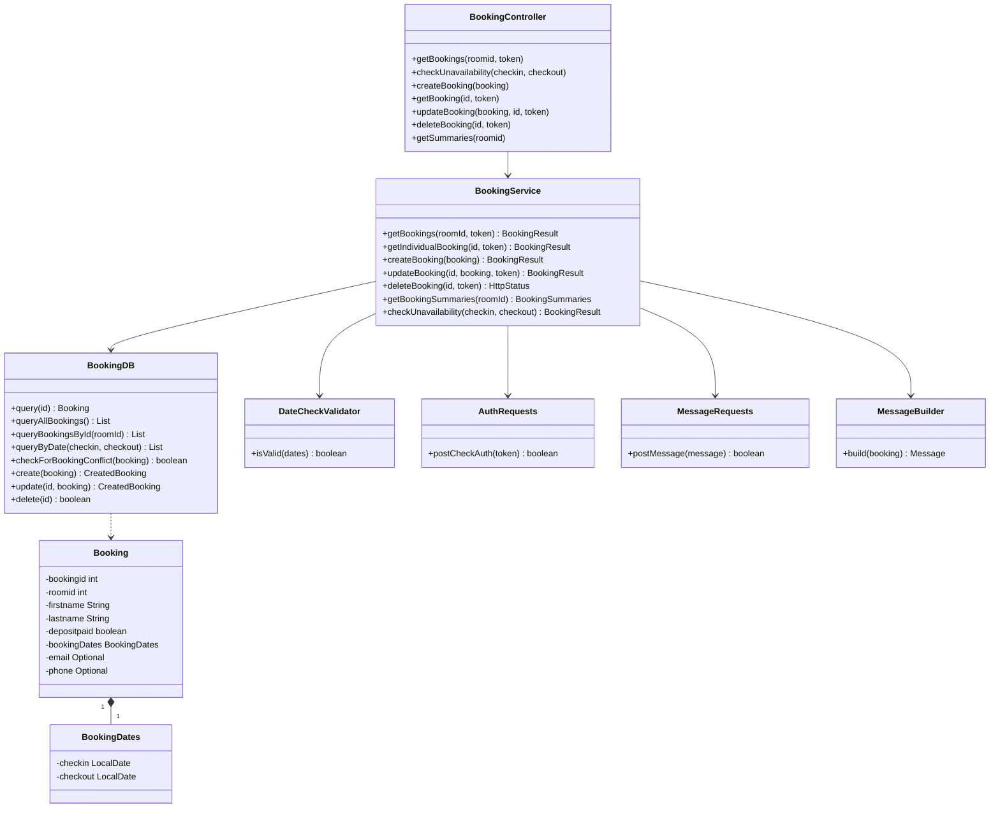
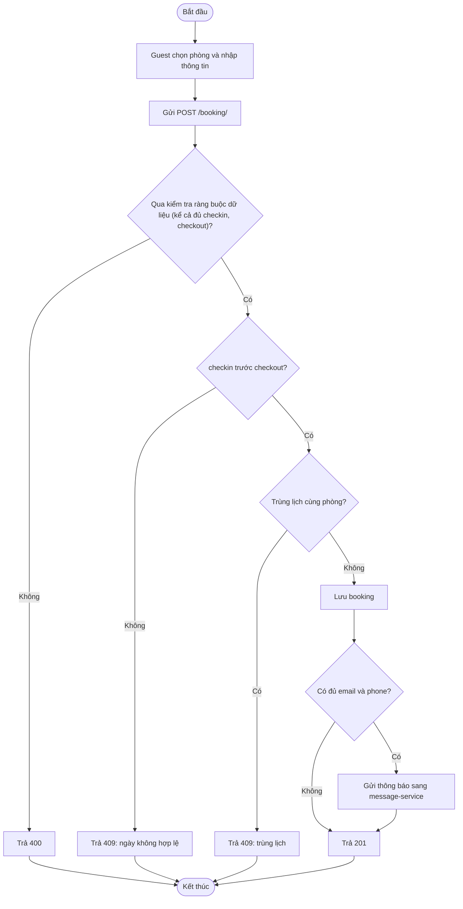
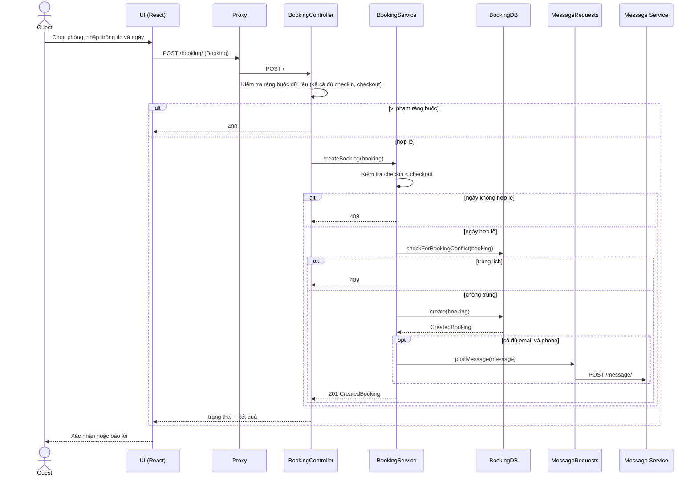
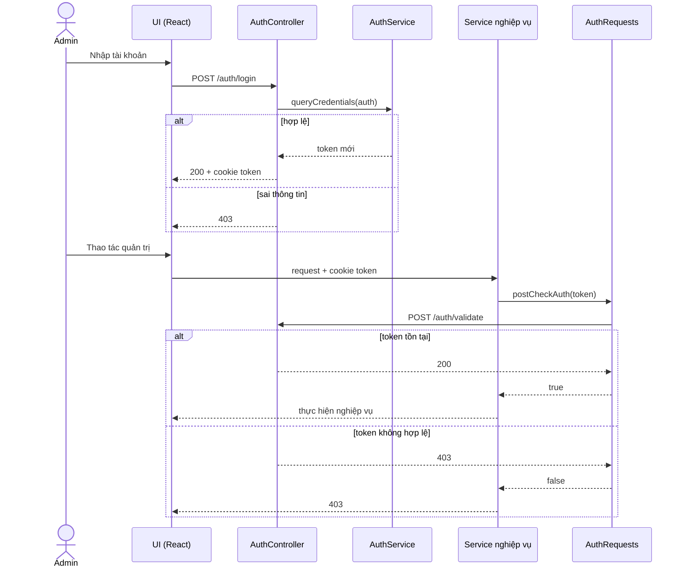
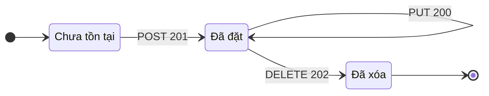

# TÀI LIỆU ĐẶC TẢ YÊU CẦU PHẦN MỀM (SRS)

**Hệ thống đặt phòng khách sạn mã nguồn mở Restful-booker Platform**

| Mục | Nội dung |
|---|---|
| Môn học | Đánh giá và kiểm định chất lượng phần mềm |
| Đề tài | Kiểm định chất lượng phần mềm hệ thống đặt phòng khách sạn mã nguồn mở Restful-booker Platform bằng Postman, JMeter và Selenium |
| Nhóm thực hiện | Nguyễn Văn Ngọc - 23010413; Nguyễn Thị Trà Mi - 23010460 |

> Tài liệu này được xây dựng bằng cách đọc mã nguồn và vận hành hệ thống trên môi trường cục bộ.

---

## Mục lục

1. Giới thiệu
2. Mô tả tổng quan
3. Yêu cầu chức năng
4. Yêu cầu giao diện ngoài
5. Mô hình hóa hệ thống
6. Quy tắc nghiệp vụ và ràng buộc dữ liệu
7. Yêu cầu phi chức năng
8. Ma trận truy vết
9. Phụ lục A: Danh mục API

---

## 1. Giới thiệu

### 1.1 Mục đích

Tài liệu mô tả yêu cầu của hệ thống Restful-booker Platform: chức năng, quy tắc nghiệp vụ, mô hình dữ liệu và yêu cầu phi chức năng. Đây là cơ sở để xây dựng Kế hoạch kiểm thử (Phần II), thiết kế test case và đánh giá chất lượng theo ISO/IEC 25010.

### 1.2 Phạm vi

Restful-booker Platform là hệ thống đặt phòng khách sạn mã nguồn mở, gồm giao diện web (React) và các dịch vụ backend (Java Spring Boot) giao tiếp qua REST API. Hệ thống hỗ trợ:

- Khách (Guest): xem thông tin khách sạn, xem phòng, đặt phòng, gửi liên hệ.
- Quản trị viên (Admin): đăng nhập, quản lý phòng, quản lý đặt phòng, xử lý tin nhắn liên hệ, xem báo cáo, cấu hình thương hiệu.

Phạm vi kiểm định của đồ án gồm các dịch vụ `auth`, `booking`, `room`, `message`, `branding`, `report` và giao diện web.

Các hành vi của hệ thống trong tài liệu được suy ra từ mã nguồn; việc đối chiếu với hệ thống chạy thật được thực hiện trong Phần III (thực hiện kiểm thử).

### 1.3 Định nghĩa và từ viết tắt

| Thuật ngữ | Ý nghĩa |
|---|---|
| SRS | Software Requirements Specification, đặc tả yêu cầu phần mềm |
| FR / NFR | Functional / Non-functional Requirement |
| BR | Business Rule, quy tắc nghiệp vụ |
| UC | Use Case |
| Guest | Người dùng chưa đăng nhập |
| Admin | Quản trị viên, đăng nhập bằng tài khoản và dùng token |
| Token | Chuỗi định danh phiên của Admin, lưu trong cookie `token` |
| BVA / EP | Boundary Value Analysis / Equivalence Partitioning |
| Booking | Một lượt đặt phòng gồm phòng, khách và khoảng ngày |

### 1.4 Tài liệu tham khảo

- Mã nguồn `restful-booker-platform` (các service auth, booking, room, message, branding, report và giao diện React).
- ISO/IEC 25010: Mô hình chất lượng sản phẩm phần mềm.
- IEEE 830 / ISO/IEC/IEEE 29148: hướng dẫn cấu trúc tài liệu đặc tả yêu cầu.

### 1.5 Bố cục tài liệu

Mục 2 mô tả tổng quan, mục 3 và 7 nêu yêu cầu chức năng và phi chức năng, mục 5 là các mô hình, mục 6 là quy tắc nghiệp vụ và ràng buộc dữ liệu, mục 8 là ma trận truy vết sang test case.

---

## 2. Mô tả tổng quan

### 2.1 Kiến trúc hệ thống

Hệ thống gồm giao diện web (ứng dụng `assets`, chạy bằng `npm run dev`, cổng 3003) và các dịch vụ backend độc lập, mỗi dịch vụ chạy trên một cổng riêng. Theo `run_locally.cmd`, không có tiến trình proxy riêng; giao diện gọi API qua đường dẫn dạng `http://localhost:3003/api/{dịch vụ}` (đã xác nhận `GET /api/branding` và `GET /api/room` trả 200), và ứng dụng `assets` nhiều khả năng chuyển tiếp request tới dịch vụ tương ứng. Mỗi dịch vụ có CSDL riêng (H2 in-memory), liên kết với nhau qua REST, không có khóa ngoại giữa các CSDL.

| Dịch vụ | Vai trò | CSDL |
|---|---|---|
| auth | Đăng nhập, cấp và kiểm tra token | ACCOUNTS, TOKENS |
| booking | Đặt phòng, kiểm tra trùng lịch, quản lý booking | BOOKINGS |
| room | Quản lý thông tin phòng, lọc phòng theo ngày | ROOMS |
| message | Tin nhắn liên hệ và thông báo đặt phòng | MESSAGES |
| branding | Thông tin thương hiệu khách sạn | BRANDINGS |
| report | Báo cáo đặt phòng, tổng hợp dữ liệu từ room và booking | Không có CSDL riêng |

### 2.2 Tác nhân

| Tác nhân | Mô tả | Quyền |
|---|---|---|
| Guest | Khách truy cập, không đăng nhập | Xem thông tin, xem phòng, đặt phòng, gửi liên hệ |
| Admin | Quản trị viên, có token hợp lệ | Toàn bộ chức năng quản trị |
| Hệ thống | Các dịch vụ gọi lẫn nhau | Xác thực token, gửi thông báo |

### 2.3 Môi trường vận hành

- Backend: Java, Spring Boot (Jakarta), CSDL H2 in-memory (`MODE=MySQL`).
- Frontend: React, truy cập bằng trình duyệt hiện đại.
- Triển khai kiểm thử: chạy cục bộ trên Windows bằng `build_locally.cmd` (build Maven rồi gọi `run_locally.cmd`). Dự án có kèm `docker-compose.yml` nhưng không dùng trong kiểm thử này.
- Dữ liệu mỗi dịch vụ được khởi tạo từ `db.sql` và `seed.sql` khi khởi động. Cơ chế reset định kỳ (`DatabaseScheduler`) chỉ chạy khi biến môi trường `dbRefresh` lớn hơn 0 (đơn vị phút).
- Khi chạy bằng `run_locally.cmd`, biến `dbRefresh` không được đặt nên dữ liệu không bị reset định kỳ; dữ liệu chỉ mất khi tắt các dịch vụ.
- Cổng: giao diện 3003; booking 3000, room 3001, branding 3002, auth 3004, report 3005, message 3006 (theo `docker-compose.yml` và các địa chỉ trong mã).

### 2.4 Ràng buộc và giả định

- Dữ liệu không bền vững: mất khi dịch vụ khởi động lại, hoặc khi reset định kỳ nếu `dbRefresh` được bật (kể cả token đăng nhập).
- Việc phân quyền dựa trên token trong cookie `token`; mỗi dịch vụ tự gọi auth-service để kiểm tra.
- Không có khóa ngoại giữa các dịch vụ; tính nhất quán giữa phòng và booking do ứng dụng đảm nhiệm.
- Hệ thống dùng cho mục đích học tập và kiểm thử, không triển khai cho khách sạn thật.

---

## 3. Yêu cầu chức năng

### 3.1 Danh sách Use Case

| Mã | Use Case | Tác nhân | FR liên quan |
|---|---|---|---|
| UC-01 | Xem thông tin khách sạn | Guest | FR-01 |
| UC-02 | Xem và lọc phòng | Guest | FR-02, FR-03, FR-04, FR-05 |
| UC-03 | Đặt phòng | Guest | FR-06, FR-25, FR-26 |
| UC-04 | Gửi liên hệ | Guest | FR-07 |
| UC-05 | Đăng nhập / Đăng xuất | Admin | FR-08, FR-09 |
| UC-06 | Quản lý phòng | Admin | FR-10, FR-11, FR-12 |
| UC-07 | Quản lý đặt phòng | Admin | FR-13, FR-14, FR-15, FR-16 |
| UC-08 | Quản lý tin nhắn | Admin | FR-17, FR-18, FR-19, FR-20, FR-21 |
| UC-09 | Xem báo cáo | Admin | FR-22 |
| UC-10 | Cấu hình thương hiệu | Admin | FR-23 |
| UC-11 | Xác thực token | Hệ thống | FR-24 |

### 3.2 Yêu cầu chức năng nhóm Guest

| Mã | Tên | Mô tả | API | Kết quả |
|---|---|---|---|---|
| FR-01 | Xem thông tin thương hiệu | Hiển thị tên, logo, mô tả, chỉ đường, liên hệ, địa chỉ, bản đồ | `GET /branding/` | 200 |
| FR-02 | Xem danh sách phòng | Liệt kê toàn bộ phòng | `GET /room/` | 200 |
| FR-03 | Xem chi tiết phòng | Hiển thị thông tin một phòng theo mã | `GET /room/{id}` | 200; 404 nếu không có |
| FR-04 | Lọc phòng còn trống theo ngày | Trả danh sách phòng sau khi loại phòng đã có booking trong khoảng ngày; cần đủ `checkin` và `checkout` | `GET /room/?checkin=&checkout=` | 200 |
| FR-05 | Xem tình trạng đặt của một phòng | Xem các khoảng ngày đã đặt của phòng; báo cáo theo phòng chỉ gồm `start`, `end` và `title` là "Unavailable", không có thông tin khách | `GET /booking/summary?roomid=`, `GET /report/room/{id}` | 200 |
| FR-06 | Đặt phòng | Khách nhập thông tin và khoảng ngày để đặt phòng; chi tiết ở 3.5 | `POST /booking/` | 201; 400; 409 |
| FR-07 | Gửi liên hệ | Gửi tin nhắn cho khách sạn | `POST /message/` | 201; 400 |

### 3.3 Yêu cầu chức năng nhóm Admin

Mọi chức năng trong nhóm này (trừ FR-08) yêu cầu token hợp lệ. Thiếu hoặc sai token → 403.

| Mã | Tên | Mô tả | API | Kết quả |
|---|---|---|---|---|
| FR-08 | Đăng nhập | Kiểm tra tài khoản, cấp token và đặt vào cookie `token` | `POST /auth/login` | 200; 403 nếu sai thông tin |
| FR-09 | Đăng xuất | Hủy token | `POST /auth/logout` | 200; 404 nếu token không tồn tại |
| FR-10 | Thêm phòng | Tạo phòng mới | `POST /room/` | 201; 400; 403 |
| FR-11 | Sửa phòng | Cập nhật thông tin phòng | `PUT /room/{id}` | 202; 400; 403; 404 |
| FR-12 | Xóa phòng | Xóa phòng theo mã | `DELETE /room/{id}` | 202; 403; 404 |
| FR-13 | Xem danh sách đặt phòng | Liệt kê booking, có thể lọc theo phòng | `GET /booking/?roomid=` | 200; 403 |
| FR-14 | Xem chi tiết đặt phòng | Xem một booking theo mã | `GET /booking/{id}` | 200; 403; 404 |
| FR-15 | Sửa đặt phòng | Cập nhật thông tin và ngày của booking, có kiểm tra trùng lịch | `PUT /booking/{id}` | 200; 400; 403; 404; 409 |
| FR-16 | Xóa đặt phòng | Xóa booking | `DELETE /booking/{id}` | 202; 403; 404 |
| FR-17 | Xem danh sách tin nhắn | Liệt kê tin nhắn liên hệ dạng tóm tắt gồm `id`, `name`, `subject`, `read` | `GET /message/` | 200 |
| FR-18 | Xem chi tiết tin nhắn | Xem đầy đủ một tin nhắn | `GET /message/{id}` | 200 |
| FR-19 | Xem số tin chưa đọc | Đếm tin nhắn chưa đọc | `GET /message/count` | 200 |
| FR-20 | Đánh dấu đã đọc | Đánh dấu một tin nhắn là đã đọc | `PUT /message/{id}/read` | 202; 403 |
| FR-21 | Xóa tin nhắn | Xóa tin nhắn theo mã | `DELETE /message/{id}` | 202; 403; 404 |
| FR-22 | Xem báo cáo tổng hợp | Báo cáo đặt phòng của tất cả phòng; mỗi mục gồm `start`, `end` (định dạng `yyyy-MM-dd`) và `title` (tên khách và tên phòng). Dữ liệu booking lấy từ booking-service bằng token của Admin | `GET /report/` | 200 |
| FR-23 | Cập nhật thương hiệu | Sửa thông tin thương hiệu khách sạn | `PUT /branding/` | 202; 400; 403 |

### 3.4 Yêu cầu chức năng của hệ thống

| Mã | Tên | Mô tả |
|---|---|---|
| FR-24 | Xác thực token | Auth-service nhận token và trả 200 nếu token tồn tại, 403 nếu không (`POST /auth/validate`). Các dịch vụ booking, room, message dùng chức năng này cho mọi thao tác quản trị |
| FR-25 | Kiểm tra trùng lịch | Khi tạo hoặc sửa booking, hệ thống từ chối nếu khoảng ngày không hợp lệ hoặc trùng với booking khác của cùng phòng (xem BR-01, BR-02) |
| FR-26 | Gửi thông báo đặt phòng | Sau khi tạo booking thành công có đủ `email` và `phone`, booking-service gửi một tin nhắn thông báo sang message-service (`POST /message/`) |

### 3.5 Đặc tả Use Case UC-03: Đặt phòng

| Mục | Nội dung |
|---|---|
| Tác nhân | Guest |
| Mục tiêu | Đặt một phòng trong khoảng ngày xác định |
| Tiền điều kiện | Phòng cần đặt đã có trong hệ thống |
| Đầu vào | `roomid`, `firstname`, `lastname`, `depositpaid`, `bookingdates` (`checkin`, `checkout`), `email` và `phone` (tùy chọn) |
| Hậu điều kiện (thành công) | Booking được lưu, trả 201 kèm mã booking; nếu có đủ `email` và `phone` thì tin nhắn thông báo được gửi sang message-service |

**Luồng chính**

1. Guest chọn phòng và nhập thông tin đặt phòng.
2. Hệ thống kiểm tra các ràng buộc dữ liệu (BR-06).
3. Hệ thống kiểm tra khoảng ngày hợp lệ (BR-01).
4. Hệ thống kiểm tra phòng không bị trùng lịch (BR-02).
5. Hệ thống lưu booking.
6. Nếu có đủ `email` và `phone`, hệ thống gửi thông báo sang message-service (FR-26).
7. Hệ thống trả 201 và hiển thị xác nhận.

**Luồng thay thế**

| Bước | Điều kiện | Kết quả |
|---|---|---|
| 2 | Vi phạm ràng buộc dữ liệu, kể cả thiếu `checkin` hoặc `checkout` | 400, báo lỗi |
| 3 | `checkin` bằng hoặc sau `checkout` | 409 |
| 4 | Trùng lịch với booking khác của phòng | 409 |

### 3.6 Đặc tả Use Case UC-05: Đăng nhập

| Mục | Nội dung |
|---|---|
| Tác nhân | Admin |
| Mục tiêu | Có phiên làm việc để dùng các chức năng quản trị |
| Đầu vào | `username`, `password` |
| Luồng chính | Admin nhập thông tin → auth-service đối chiếu tài khoản → sinh token ngẫu nhiên 16 ký tự, lưu vào CSDL → trả 200 và đặt cookie `token` |
| Luồng thay thế | Sai thông tin → 403; không lưu được token → 500 |
| Đăng xuất | Admin gọi `POST /auth/logout` kèm token → token bị xóa; token cũ không còn dùng được (403) |

---

## 4. Yêu cầu giao diện ngoài

### 4.1 Giao diện người dùng

- Khu vực Guest: thông tin khách sạn, danh sách phòng, đặt phòng, biểu mẫu liên hệ.
- Khu vực Admin: đăng nhập, quản lý phòng, quản lý đặt phòng, tin nhắn, báo cáo, cấu hình thương hiệu.

### 4.2 Giao diện giao tiếp

- Giao thức: REST qua HTTP, dữ liệu JSON.
- Xác thực: cookie `token`, kiểm tra bằng `POST /auth/validate`.
- Giao tiếp nội bộ: booking → auth, booking → message, room → auth, room → booking, message → auth.
- Danh mục API đầy đủ: xem Phụ lục A.

---

## 5. Mô hình hóa hệ thống

Các sơ đồ dưới đây dùng Mermaid (hiển thị trực tiếp trên GitHub và VS Code). Bản PlantUML tương ứng nằm trong `SRS/diagrams/`.

### 5.1 Sơ đồ Use Case

*Nguồn PlantUML: `diagrams/usecase.puml`*

### 5.2 Mô hình dữ liệu (ERD)

Mỗi dịch vụ có CSDL riêng. Quan hệ giữa phòng và booking là tham chiếu logic qua `roomid`, không có khóa ngoại.

*Nguồn PlantUML: `diagrams/erd.puml`*

Ghi chú: `email` và `phone` của booking chỉ có trong yêu cầu đặt phòng, không lưu trong bảng BOOKINGS; chúng được dùng để tạo tin nhắn thông báo.

### 5.3 Sơ đồ lớp (booking-service)

*Nguồn PlantUML: `diagrams/class.puml`, `diagrams/class-other-services.puml`*

Các dịch vụ auth, room, message, branding, report có cấu trúc Controller → Service → DB tương tự; xem `diagrams/class-other-services.puml`.

### 5.4 Sơ đồ hoạt động: Đặt phòng

*Nguồn PlantUML: `diagrams/activity-booking.puml`*

### 5.5 Sơ đồ tuần tự: Đặt phòng

*Nguồn PlantUML: `diagrams/sequence-booking.puml`*

### 5.6 Sơ đồ tuần tự: Đăng nhập và xác thực Admin

*Nguồn PlantUML: `diagrams/sequence-login.puml`, `diagrams/sequence-admin-auth.puml`*

### 5.7 Sơ đồ trạng thái: Vòng đời booking

Dùng làm cơ sở cho State Transition Testing. Sơ đồ chỉ vẽ các chuyển trạng thái thành công; các trường hợp bị từ chối và thao tác trên booking không tồn tại được liệt kê trong bảng chuyển trạng thái bên dưới.

**Bảng chuyển trạng thái**

| Mã | Trạng thái hiện tại | Sự kiện | Điều kiện | Trạng thái kế tiếp | Mã trạng thái |
|---|---|---|---|---|---|
| T1 | Chưa tồn tại | `POST /booking/` | Dữ liệu hợp lệ, ngày hợp lệ, không trùng lịch | Đã đặt | 201 |
| T2 | Chưa tồn tại | `POST /booking/` | Vi phạm ràng buộc dữ liệu | Chưa tồn tại | 400 |
| T3 | Chưa tồn tại | `POST /booking/` | Ngày không hợp lệ hoặc trùng lịch | Chưa tồn tại | 409 |
| T4 | Đã đặt | `PUT /booking/{id}` | Token hợp lệ, ngày hợp lệ, không trùng lịch với booking khác | Đã đặt (đã cập nhật) | 200 |
| T5 | Đã đặt | `PUT /booking/{id}` | Ngày không hợp lệ hoặc trùng lịch với booking khác | Đã đặt (không đổi) | 409 |
| T6 | Đã đặt | `PUT /booking/{id}` | Không có token hợp lệ | Đã đặt (không đổi) | 403 |
| T7 | Đã đặt | `GET /booking/{id}` | Token hợp lệ | Đã đặt (không đổi) | 200 |
| T8 | Đã đặt | `DELETE /booking/{id}` | Token hợp lệ | Đã xóa | 202 |
| T9 | Đã đặt | `DELETE /booking/{id}` | Không có token hợp lệ | Đã đặt (không đổi) | 403 |
| T10 | Đã xóa | `GET /booking/{id}` | Token hợp lệ | Đã xóa | 404 |
| T11 | Đã xóa | `PUT /booking/{id}` | Token và ngày hợp lệ | Đã xóa | 404 |
| T12 | Đã xóa | `DELETE /booking/{id}` | Token hợp lệ | Đã xóa | 404 |

---

## 6. Quy tắc nghiệp vụ và ràng buộc dữ liệu

### 6.1 Quy tắc nghiệp vụ

| Mã | Quy tắc |
|---|---|
| BR-01 | `checkin` và `checkout` bắt buộc; thiếu một trong hai vi phạm BR-06 → 400. `checkin` phải trước `checkout` (không cho bằng nhau); vi phạm → 409 |
| BR-02 | Một phòng không được có hai booking trùng khoảng ngày. Booking mới được phép bắt đầu đúng ngày booking trước kết thúc. Vi phạm → 409 |
| BR-03 | Tạo booking không cần đăng nhập; xem, sửa, xóa booking cần token Admin, sai token → 403 |
| BR-04 | Khi tạo booking có đủ `email` và `phone`, hệ thống gửi thông báo sang message-service |
| BR-05 | Dữ liệu lưu trong CSDL in-memory; chỉ được reset định kỳ khi biến môi trường `dbRefresh` lớn hơn 0 |
| BR-06 | Ràng buộc dữ liệu từng đối tượng theo mục 6.2. Vi phạm → 400 |
| BR-07 | Gửi liên hệ không cần đăng nhập; xóa và đánh dấu đã đọc tin nhắn cần token Admin |
| BR-08 | Đăng nhập thành công thì cấp token và đặt vào cookie `token`; thông tin sai → 403 |
| BR-09 | Xem thông tin phòng không cần đăng nhập; tạo, sửa, xóa phòng cần token Admin |
| BR-10 | Lọc phòng theo ngày chỉ áp dụng khi có đủ cả `checkin` và `checkout`; thiếu một trong hai thì trả toàn bộ phòng |
| BR-11 | Phòng: `type` thuộc {Single, Double, Twin, Family, Suite}; `roomPrice` từ 1 đến 999 |
| BR-12 | Tin nhắn liên hệ: tất cả trường bắt buộc, `email` đúng định dạng |
| BR-13 | Token do auth-service sinh khi đăng nhập thành công và lưu trong CSDL; các dịch vụ khác xác thực bằng cách hỏi auth-service |
| BR-14 | Xem thông tin thương hiệu không cần token; cập nhật cần token Admin |
| BR-15 | Báo cáo tổng hợp cần token Admin; báo cáo theo từng phòng không yêu cầu token |

### 6.2 Ràng buộc dữ liệu

**Booking**

| Trường | Ràng buộc |
|---|---|
| `roomid` | số nguyên ≥ 1 |
| `firstname` | không trống, 3–18 ký tự |
| `lastname` | không trống, 3–30 ký tự |
| `depositpaid` | boolean (thiếu → false) |
| `bookingdates` | `checkin`, `checkout` theo BR-01 |
| `email` (tùy chọn) | không rỗng, đúng định dạng email |
| `phone` (tùy chọn) | không rỗng, 11–21 ký tự |

**Room**

| Trường | Ràng buộc |
|---|---|
| `roomName` | bắt buộc, không rỗng |
| `type` | bắt buộc, một trong Single, Double, Twin, Family, Suite |
| `roomPrice` | 1–999 |
| `accessible`, `image`, `description`, `features` | không có ràng buộc |

**Message**

| Trường | Ràng buộc |
|---|---|
| `name` | bắt buộc, không trống |
| `email` | bắt buộc, đúng định dạng email |
| `phone` | bắt buộc, 11–21 ký tự |
| `subject` | bắt buộc, 5–100 ký tự |
| `description` | bắt buộc, 20–2000 ký tự |

**Branding**

| Trường | Ràng buộc |
|---|---|
| `name` | không trống, 3–100 ký tự, chỉ gồm chữ cái không dấu, `&` và khoảng trắng |
| `logoUrl` | không trống, đúng định dạng URL |
| `description` | không trống, 3–500 ký tự, chỉ gồm chữ cái không dấu, `,`, `&`, `.` và khoảng trắng |
| `directions` | không trống |
| `map.latitude`, `map.longitude` | số thực |
| `contact.name` | không trống, 3–40 ký tự, chỉ gồm chữ cái không dấu, `&` và khoảng trắng |
| `contact.phone` | không trống; ràng buộc khai báo là `@Min(11)` trên chuỗi |
| `contact.email` | không trống, đúng định dạng email |
| `address.line1`, `line2`, `postTown`, `county`, `postCode` | đều bắt buộc, không trống |

**Auth**

| Trường | Ràng buộc |
|---|---|
| `username`, `password` | chuỗi, không có ràng buộc định dạng |
| Token | chuỗi ngẫu nhiên 16 ký tự do hệ thống sinh |

---

## 7. Yêu cầu phi chức năng

Các ngưỡng số ở NFR-01 là ngưỡng đề xuất, sẽ được hiệu chỉnh trong Kế hoạch kiểm thử (Phần II).

| Mã | Đặc tính ISO/IEC 25010 | Yêu cầu | Cách đánh giá |
|---|---|---|---|
| NFR-01 | Performance Efficiency | Với 50 người dùng đồng thời, `GET /room/` và `POST /booking/` có thời gian phản hồi trung bình ≤ 1 giây, p95 ≤ 2 giây, tỷ lệ lỗi < 1% | JMeter: load, stress, spike |
| NFR-02 | Reliability | Khi auth-service hoặc message-service không khả dụng, hệ thống trả mã lỗi có kiểm soát và không để dữ liệu mâu thuẫn (client nhận lỗi nhưng booking vẫn được lưu) | Dừng container dịch vụ phụ thuộc, quan sát kết quả |
| NFR-03 | Reliability (toàn vẹn dữ liệu) | Khi nhiều yêu cầu đồng thời đặt cùng một phòng và cùng khoảng ngày, chỉ một yêu cầu được thành công (không overbooking) | JMeter: nhiều luồng cùng đặt một phòng |
| NFR-04 | Security | Mọi API quản trị phải xác thực token; thiếu hoặc sai token bị từ chối với 403; dữ liệu cá nhân của khách chỉ Admin được xem | Postman: kiểm thử theo vai trò Guest / Admin |
| NFR-05 | Security | Token có thời hạn và sinh ngẫu nhiên an toàn; mật khẩu không lưu hoặc so khớp ở dạng văn bản thô; tham số đầu vào không được ghép trực tiếp vào câu SQL; cookie phiên có thuộc tính bảo vệ | Rà soát mã (static review), Postman |
| NFR-06 | Usability | Luồng đặt phòng hoàn thành được trong một lần điền biểu mẫu; thông báo lỗi nêu rõ trường vi phạm; dữ liệu hợp lý (ví dụ tên tiếng Việt có dấu) không bị từ chối vô lý | Selenium, quan sát giao diện |
| NFR-07 | Compatibility / Portability | Chạy được trên các trình duyệt phổ biến (Chrome, Firefox, Edge) và triển khai bằng Docker | Selenium, chạy thử môi trường Docker |
| NFR-08 | Functional Suitability | Dữ liệu không hợp lệ phải trả mã 4xx rõ ràng, không trả 5xx; mã trạng thái nhất quán giữa các dịch vụ | Postman: EP và BVA |

---

## 8. Ma trận truy vết

Cột Test Case được điền ở Phần II khi có bộ test case.

| FR | Use Case | API | Test Case |
|---|---|---|---|
| FR-01 | UC-01 | `GET /branding/` | |
| FR-02 | UC-02 | `GET /room/` | |
| FR-03 | UC-02 | `GET /room/{id}` | |
| FR-04 | UC-02 | `GET /room/?checkin&checkout` | |
| FR-05 | UC-02 | `GET /booking/summary`, `GET /report/room/{id}` | |
| FR-06 | UC-03 | `POST /booking/` | |
| FR-07 | UC-04 | `POST /message/` | |
| FR-08 | UC-05 | `POST /auth/login` | |
| FR-09 | UC-05 | `POST /auth/logout` | |
| FR-10 | UC-06 | `POST /room/` | |
| FR-11 | UC-06 | `PUT /room/{id}` | |
| FR-12 | UC-06 | `DELETE /room/{id}` | |
| FR-13 | UC-07 | `GET /booking/` | |
| FR-14 | UC-07 | `GET /booking/{id}` | |
| FR-15 | UC-07 | `PUT /booking/{id}` | |
| FR-16 | UC-07 | `DELETE /booking/{id}` | |
| FR-17 | UC-08 | `GET /message/` | |
| FR-18 | UC-08 | `GET /message/{id}` | |
| FR-19 | UC-08 | `GET /message/count` | |
| FR-20 | UC-08 | `PUT /message/{id}/read` | |
| FR-21 | UC-08 | `DELETE /message/{id}` | |
| FR-22 | UC-09 | `GET /report/` | |
| FR-23 | UC-10 | `PUT /branding/` | |
| FR-24 | UC-11 | `POST /auth/validate` | |
| FR-25 | UC-03, UC-07 | `POST /booking/`, `PUT /booking/{id}` | |
| FR-26 | UC-03 | `POST /message/` (từ booking-service) | |

---

## 9. Phụ lục A: Danh mục API

Tiền tố `/booking`, `/room`, `/message`, `/auth`, `/branding`, `/report` là tiền tố đường dẫn của từng dịch vụ. Giao diện mở tại `http://localhost:3003`; qua giao diện, API được gọi theo dạng `http://localhost:3003/api/{dịch vụ}` (đã xác nhận `GET /api/branding` và `GET /api/room` trả 200). Gọi thẳng dịch vụ có dạng `http://localhost:{cổng}/{dịch vụ}/...` (cổng ở mục 2.3). "Token" nghĩa là cần cookie `token` của Admin.

| Dịch vụ | Method + đường dẫn | Token | Mã trạng thái |
|---|---|---|---|
| booking | `GET /booking/?roomid=` | Cần | 200, 403 |
| booking | `GET /booking/unavailable?checkin&checkout` | Không | 200 |
| booking | `POST /booking/` | Không | 201, 400, 409 |
| booking | `GET /booking/{id}` | Cần | 200, 403, 404 |
| booking | `PUT /booking/{id}` | Cần | 200, 400, 403, 404, 409 |
| booking | `DELETE /booking/{id}` | Cần | 202, 403, 404 |
| booking | `GET /booking/summary?roomid=` | Không | 200 |
| room | `GET /room/` (tùy chọn `checkin`, `checkout`) | Không | 200 |
| room | `GET /room/{id}` | Không | 200, 404 |
| room | `POST /room/` | Cần | 201, 400, 403 |
| room | `PUT /room/{id}` | Cần | 202, 400, 403, 404 |
| room | `DELETE /room/{id}` | Cần | 202, 403, 404 |
| message | `GET /message/` | Không | 200 |
| message | `GET /message/count` | Không | 200 |
| message | `GET /message/{id}` | Không | 200, 404 |
| message | `POST /message/` | Không | 201, 400 |
| message | `PUT /message/{id}/read` | Cần | 202, 403 |
| message | `DELETE /message/{id}` | Cần | 202, 403, 404 |
| auth | `POST /auth/login` | Không | 200, 403 |
| auth | `POST /auth/validate` | Không | 200, 403 |
| auth | `POST /auth/logout` | Không | 200, 404 |
| branding | `GET /branding/` | Không | 200 |
| branding | `PUT /branding/` | Cần | 202, 400, 403 |
| report | `GET /report/` | Cần (cookie bắt buộc) | 200, 400 nếu thiếu cookie |
| report | `GET /report/room/{id}` | Không | 200 |
